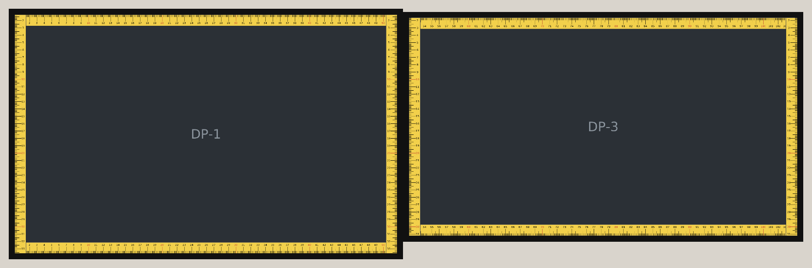
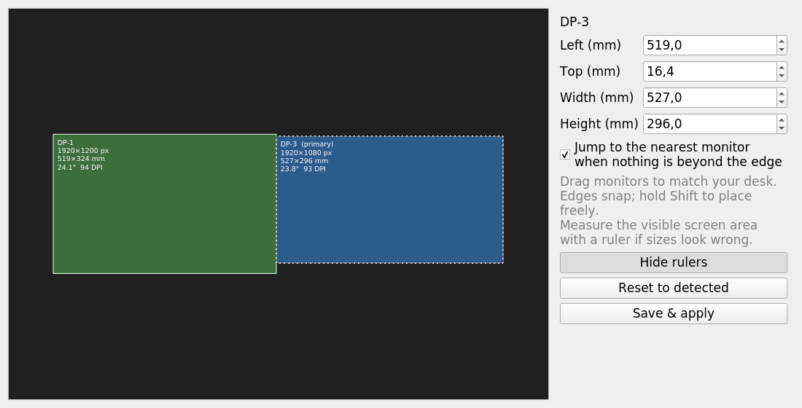
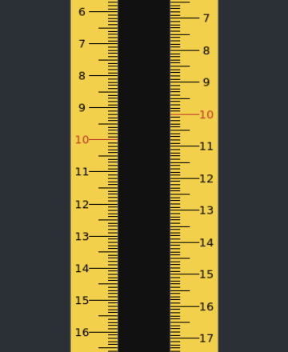
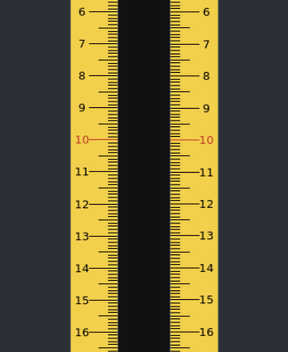

# TrueEdge

Moves the mouse between monitors where they **physically** meet instead of where their pixel edges happen to line up. Inspired by [LittleBigMouse](https://github.com/mgth/littlebigmouse), which only runs on Windows. This version is for Linux/X11 (built and tested on KDE Plasma, Ubuntu 20.04).



Without TrueEdge, X moves the cursor across where the pixel edges meet:
- monitors of different height or size leave parts of an edge that lead nowhere, so the cursor sticks there;
- every crossing keeps the pixel row, even when that row is at a different physical height on the other screen.

TrueEdge crosses where the screens really touch. Where nothing is straight across, it jumps to the nearest point on the other monitor.

## The layout editor



`trueedge-config` shows every monitor at its real size in millimetres. Drag them until they sit like they do on your desk: edges snap, and Shift places freely. Each monitor shows its resolution, size, diagonal and DPI. Fix the size if the EDID is wrong, then click **Save & apply**.

### Aligning with the rulers

**Show rulers** puts a yellow ruler along every screen edge. Every monitor uses the same millimetre coordinates from the layout: ticks every mm, a number every cm, and red every 10 cm.

Look across a bezel. When the layout doesn't match the desk, the marks don't meet:

| Layout 8 mm off | Layout matches the desk |
|---|---|
|  |  |

- **Position:** drag the monitor, or nudge **Left/Top**, until the marks continue in a straight line (10 meets 10). The rulers update live.
- **Size:** hold a real ruler against the screen. If 10 cm on screen isn't 10 cm, fix **Width/Height**.
- **Save & apply** does three things:
  1. writes the layout;
  2. reloads `trueedged`;
  3. moves the real screens with `xrandr --pos`, so their pixel arrangement matches the layout. Neighbours keep touching in pixels and are offset by their mm offset along the shared edge. Windows, wallpaper and screenshots then line up across the bezel too.

## How it works

- `trueedged` (C, ~500 lines) reads monitors from RandR. It takes physical sizes from EDID and swaps them for rotated outputs.
- It puts an XFixes **pointer barrier** on every pixel edge shared by two monitors, so X never crosses on its own.
- It listens to **XInput2 raw motion**. When the cursor sits on a monitor edge and the mouse keeps pushing outwards, it does three things:
  1. converts the exit point to millimetres;
  2. carries it straight across to the monitor that is really there, crossing bezels and gaps (or, with `jump 1`, to the nearest one when nothing is straight across);
  3. warps the cursor to the matching pixel.
- It reloads on SIGHUP and when the RandR layout changes (hotplug, rotation, `xrandr`).
- Only one instance runs per session (lock in `$XDG_RUNTIME_DIR/trueedged.lock`).

## Use

```sh
make                 # needs libx11-dev libxi-dev libxrandr-dev libxfixes-dev
./trueedged &        # run the daemon
./trueedge-config    # arrange monitors, Save & apply (trueedged reloads)
make install         # ~/.local/bin + KDE autostart (~/.config/autostart/trueedged.desktop)
```

Layout file: `~/.config/trueedge/layout.conf`

```
jump 1                                # nothing straight across: go to the nearest monitor
monitor DP-1 0.0 12.4 519.0 324.0     # name  left top width height (mm)
monitor DP-3 519.0 16.4 527.0 296.0
```

Monitors missing from the file get a default position next to their pixel neighbour.

Debugging without touching the cursor:

```sh
./trueedged --print [--defaults]    # layout in use / as detected
./trueedged --test 1919 600 3 0     # where a move of (+3, 0) from (1919, 600) lands -> "1920 591"
./trueedged --test 1919 1150 3 0    # below DP-3's bottom edge: jumps to its nearest point -> "1920 1094"
```

Regenerate the screenshots (rendered off-screen from the current layout, without touching the real screens):

```sh
QT_QPA_PLATFORM=offscreen python3 tools/screenshots.py
```

## Not supported yet

- Per-monitor pointer speed / DPI scaling. Both monitors here are about 93 DPI, so it isn't needed.
- Wayland. trueedged needs an X11 session, because Wayland doesn't let clients warp the global pointer.
- Corner-only (diagonal) crossings and wrap-around.
